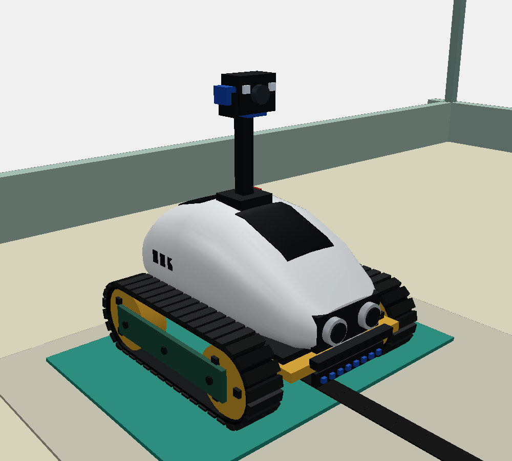

# VETRA

Simulação de um robô de inspeção fitossanitária em estufa. O robô percorre 12 canteiros, captura imagens de folhas e envia os recortes a um classificador YOLOv5s-cls. Um painel local mostra a missão, o histórico e as evidências de cada análise.



## Requisitos

- Windows e Python 3.13 (ambiente validado: 3.13.14, CPU).
- Para a simulação completa: CoppeliaSim Edu com a API remota ZMQ disponível na porta `23000`.
- Para a demonstração web: o CoppeliaSim não é necessário.

Na primeira execução, os iniciadores criam `server/.venv` e instalam as dependências. O checkpoint do modelo já está em `server/models/best.pt`.

## Como executar

Na pasta `script shell`, abra um dos iniciadores:

| Modo | Arquivo | Painel |
| --- | --- | --- |
| Simulação no CoppeliaSim | `Iniciar Inspecao Estufa.cmd` | <http://127.0.0.1:8000> |
| Demonstração sem CoppeliaSim | `Demonstracao Web Estufa.cmd` | <http://127.0.0.1:8001> |

No painel, clique em **Inspecionar agora**. O robô visita os canteiros e para no ponto STOP; **Voltar à base** retorna ao START. Use `Ctrl+C` no terminal para encerrar.

Para executar manualmente no PowerShell, a partir da raiz do projeto:

```powershell
python -m venv server\.venv
.\server\.venv\Scripts\python.exe -m pip install -r robot\requirements.txt
.\server\.venv\Scripts\python.exe -m robot.main
```

Para a demonstração web, substitua o último comando por:

```powershell
.\server\.venv\Scripts\python.exe -m robot.main --demo --web-port 8001 --data-dir server/data-demo
```

O iniciador procura o CoppeliaSim em `C:\Program Files\CoppeliaRobotics\CoppeliaSimEdu\coppeliaSim.exe`. Se ele estiver instalado em outro local, abra o simulador antes de iniciar a missão. A cena principal é `robot/scenes/AgroBotEstufa.ttt`.

## Como funciona

1. `robot/crops.json` define a cultura de cada canteiro.
2. Uma foto de referência da cultura recebe variações simuladas de iluminação, enquadramento, oclusão e desfoque. Na cena do CoppeliaSim, ela aparece como uma folha plana texturizada.
3. O robô captura a cena, recorta a região central e verifica a qualidade da imagem.
4. O recorte é enviado por HTTP ao modelo. O painel guarda a imagem analisada, a captura original quando disponível, a proveniência e o resultado.

O conjunto incluído tem 54 fotos de cinco culturas. Tomate, pimentão, morango e alface estão configurados nos canteiros; fotos de batata e laranja também estão disponíveis. O checkpoint não cobre alface, portanto esses canteiros ficam sem diagnóstico. As fotos e seus hashes estão em `robot/simulation_photos/manifest.json`.

## Estrutura

| Caminho | Conteúdo |
| --- | --- |
| `robot/` | Missão, navegação, captura, cenas e fotos de simulação |
| `server/src/` | Painel, API, histórico e inferência |
| `server/models/best.pt` | Checkpoint de classificação |
| `server/vendor/yolov5/` | Código YOLOv5 fixado para esta integração |
| `server/knowledge/pragas_sintomas.json` | Relações, fontes e ressalvas usadas na interpretação |
| `script shell/` | Iniciadores para Windows |
| `GUIA_PARA_RODAR.txt` | Guia detalhado de execução, API e testes |

Os bancos SQLite, logs e ambientes virtuais são dados locais de execução e não entram no Git.

## Testes

```powershell
.\server\.venv\Scripts\python.exe -m pip install -r server\requirements\dev.txt
.\server\.venv\Scripts\python.exe -m unittest discover -s robot/tests -v
.\server\.venv\Scripts\python.exe -m unittest discover -s server/tests -v
```

Para testes com o checkpoint real e uma missão completa, consulte `GUIA_PARA_RODAR.txt`.

## Limitações

Este é um ambiente de **simulação**. As variações das fotos não representam medições de uma câmera real nem validação independente em campo. A saída do modelo serve para triagem visual: não confirma doença, presença de pragas ou gravidade, e não prescreve defensivos. A confiança softmax não é uma probabilidade calibrada. Resultados abaixo de 70% ou com cultura divergente são tratados como inconclusivos.

O código YOLOv5 vendorizado mantém a licença de origem; consulte `server/vendor/yolov5/LICENSE`. Para a origem das fotos e do modelo, veja o [guia detalhado](GUIA_PARA_RODAR.txt) e o [manifesto das imagens](robot/simulation_photos/manifest.json).
